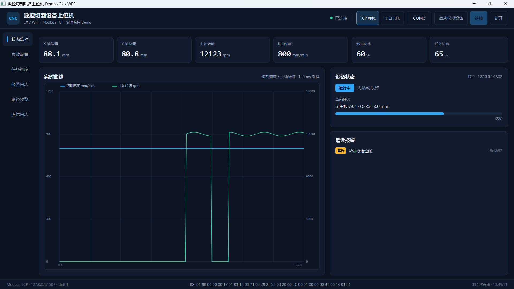
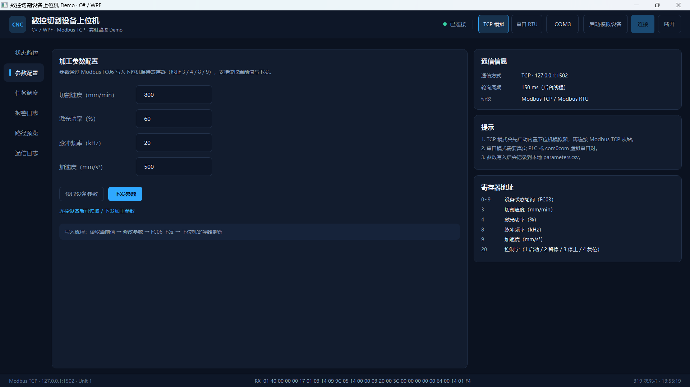
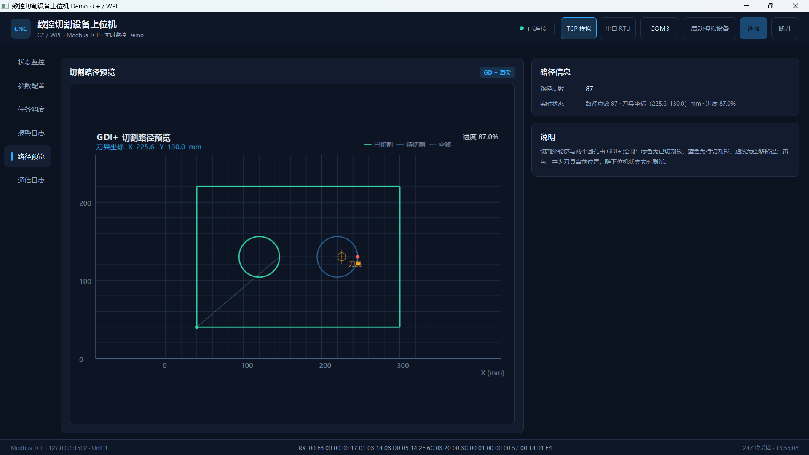
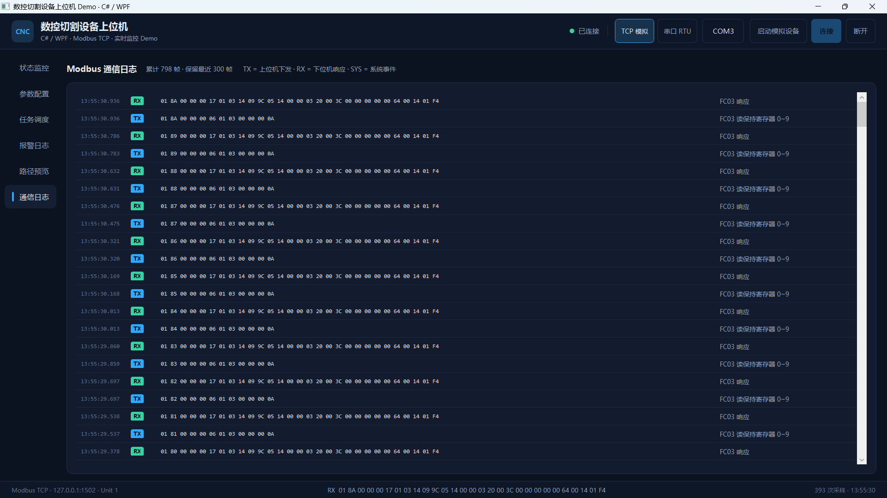
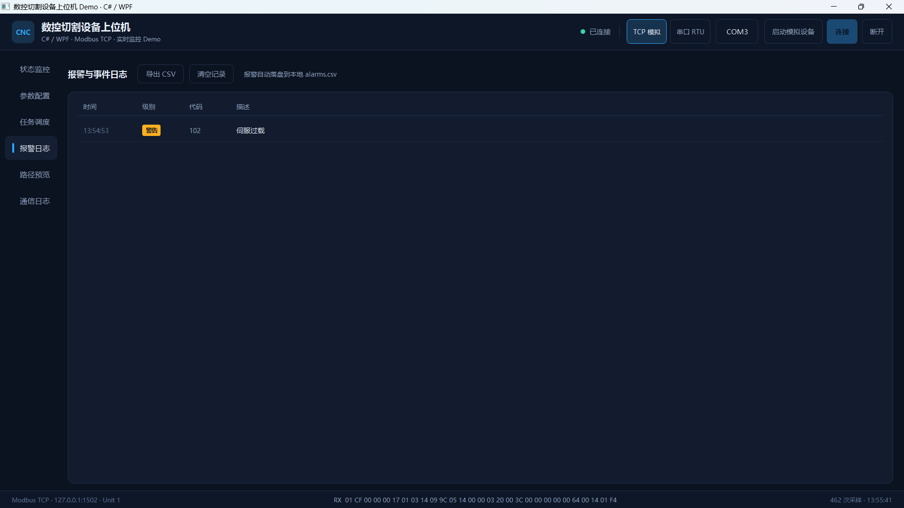

# 数控切割设备上位机 Demo（C# / WPF）

面向工控上位机方向的学习 / 求职演示项目：用 **C# + WPF** 实现数控切割设备上位机，
包含 **Modbus TCP/RTU 通信、设备状态监控、参数下发、任务调度、报警记录、GDI+ 切割路径预览**。
内置下位机模拟器，不需要真实 PLC 也能完整运行。

> **本仓库包含两个设备软件 Demo：**
> - `CncHmiDemo/`：C# / WPF 数控切割设备上位机（Modbus TCP/RTU、状态监控、GDI+ 路径）
> - [`cpp-device-comm-demo/`](cpp-device-comm-demo/README.md)：C++17 设备通信与状态机（Modbus TCP、Socket、多线程）



## 功能

| 页面 | 内容 |
| --- | --- |
| 状态监控 | X/Y 轴、主轴转速、切割速度、功率、加工进度等 KPI；实时曲线；设备状态机；最近报警 |
| 参数配置 | 切割速度 / 激光功率 / 脉冲频率 / 加速度的读取与下发（Modbus FC06） |
| 任务调度 | 任务队列、启动 / 暂停 / 停止（控制字）、加工进度与任务状态流转 |
| 报警日志 | 报警等级 / 代码 / 描述，CSV 导出，本地落盘 |
| 路径预览 | GDI+ 绘制外轮廓 + 两个圆孔，已切割 / 待切割 / 空移路径分段着色，刀具位置实时刷新 |
| 通信日志 | Modbus 原始帧（TX / RX / SYS）、FC03 / FC06、MBAP 与 RTU 帧实时展示 |

## 技术栈

- **语言 / 框架**：C#、.NET 9、WPF、XAML、MVVM（INotifyPropertyChanged + ICommand）
- **通信**：Modbus TCP（MBAP + FC03 / FC06）、Modbus RTU（CRC16）、TCP Socket、串口 `SerialPort`
- **并发**：后台轮询线程（`Task` + `CancellationToken`）、`SemaphoreSlim` 串行化请求、线程安全环形缓冲
- **图形**：WPF 自绘实时曲线（`OnRender` + `StreamGeometry`）、GDI+（`System.Drawing`）路径渲染、Bitmap 互操作

## 运行

环境：Windows 10/11 + .NET 9 SDK。

```bash
dotnet run --project CncHmiDemo\CncHmiDemo.csproj
```

也可以双击 `run.bat`，或用 Visual Studio 打开 `CncHmiDemo.sln` 运行。

启动后程序会自动启动内置下位机模拟器（`127.0.0.1:1502`）并连接；进入「任务调度」点击
「开始加工」，再回到「状态监控」即可看到实时曲线、设备状态与报警；「路径预览」查看 GDI+ 切割路径。

## 项目结构

```
CncHmiDemo/
├─ Common/             ObservableObject、RelayCommand
├─ Models/             设备快照、报警、任务、切割路径
├─ Services/
│  ├─ ModbusCodec.cs           Modbus RTU/TCP 帧编码 + CRC16
│  ├─ TcpModbusClient.cs       Modbus TCP 客户端（后台轮询）
│  ├─ SerialModbusClient.cs    Modbus RTU 串口客户端
│  ├─ DeviceSimulator.cs       内置下位机模拟器（TCP 从站 + 状态机 + 报警）
│  ├─ GdiPathRenderer.cs       GDI+ 路径渲染
│  └─ HistoryStore.cs          报警 / 参数 CSV 记录
├─ Controls/           RealtimeChart（WPF 自绘曲线）+ ChartBuffer
├─ ViewModels/         MainViewModel（连接、轮询、任务、报警、参数）
├─ Views/              6 个功能页面
├─ Themes/             深色工控主题
└─ MainWindow.xaml     整体布局与导航
```

## Modbus 寄存器映射（模拟器）

| 地址 | 含义 |
| --- | --- |
| 0~9 | X/Y 坐标、主轴转速、切割速度、功率、状态、报警码、进度、脉冲频率、加速度（FC03 轮询） |
| 3 | 切割速度设定（mm/min） |
| 4 | 激光功率设定（%） |
| 8 | 脉冲频率设定（kHz） |
| 9 | 加速度设定（mm/s²） |
| 20 | 控制字：1 启动 / 2 暂停 / 3 停止 / 4 报警复位（FC06 写入） |

## 关键实现

- **Modbus 协议**：MBAP 报文头、事务号、FC03 读保持寄存器、FC06 写单寄存器；RTU 模式使用 CRC16。
- **多线程与 UI 刷新**：后台轮询线程不直接操作 UI，统一 `Dispatcher.BeginInvoke`；`SemaphoreSlim` 避免轮询与写指令并发使用同一 Socket。
- **通信可靠性**：读超时、断线事件、异常日志；下位机寄存器读写加锁，避免线程竞争。
- **WPF 自定义绘制**：`FrameworkElement.OnRender` + `DrawingContext` 绘制实时曲线，`ChartBuffer` 环形缓冲保存最近 36 秒数据。
- **GDI+ 与 WPF 互操作**：`System.Drawing.Bitmap/Graphics` 渲染切割路径，再转 `BitmapSource` 显示；切割段 / 空移段用不同线型区分。
- **设备状态机**：待机 / 运行 / 暂停 / 报警四态，控制字驱动状态迁移，报警自动恢复与复位。

## 截图

| 参数配置 | 路径预览 |
| --- | --- |
|  |  |

| 通信日志 | 报警日志 |
| --- | --- |
|  |  |

## 说明

- 串口 RTU 代码已实现，但需要真实 PLC 或 com0com 虚拟串口对才能实测；默认演示走 TCP 模拟器。
- 本项目为个人学习 / 求职演示项目，不是生产级工控软件，未在真实设备上做过安全联锁与现场验证。
